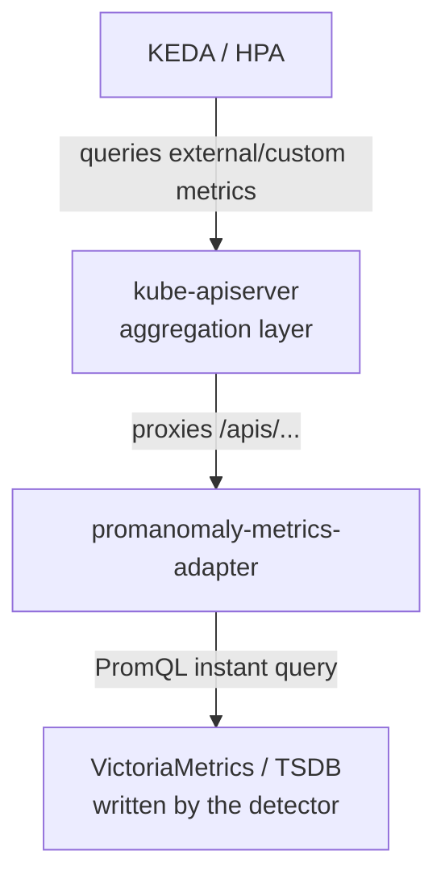

# Kubernetes Metrics Adapter

The metrics adapter is an **opt-in**, stateless sidecar that exposes promanomaly’s anomaly metrics through the Kubernetes `external.metrics.k8s.io` and `custom.metrics.k8s.io` APIs. This lets HPA and KEDA treat anomaly signals exactly like any other metric.

promanomaly remains the **metrics provider**; the autoscaler remains the **decision maker**. The adapter never makes scaling decisions itself.

Deploy it with the [`promanomaly-metrics-adapter`](../charts/promanomaly-metrics-adapter/) Helm chart (disabled by default) or run it directly via `promanomaly adapter --config adapter.yaml`.

## Architecture



Two `APIService` objects register the adapter:
- `external.metrics.k8s.io/v1beta1` — for KEDA `external` triggers and HPA `External` metric source (recommended).
- `custom.metrics.k8s.io/v1beta1` — for HPA `Object`/`Pods` rules on Kubernetes objects.

Every value is fetched live from the TSDB; the adapter is completely stateless.

It also exposes its own operational metrics on `/metrics`:
- `anomaly_adapter_requests_total{api,metric,outcome}`
- `anomaly_adapter_tsdb_failures_total{metric}`

## Exposed Metrics (default allow-list)

| Metric                     | Typical use                              |
|----------------------------|------------------------------------------|
| `anomaly_density`          | Fraction of a group that is anomalous (recommended scaling signal) |
| `anomaly_severity`         | 0–1 normalized severity                  |
| `anomaly_active_series`    | Count of currently firing series         |
| `anomaly_outside_threshold`| Per-series 0/1 firing flag               |

You can trim this list. `anomaly_score` is deliberately **not** included by default.

## Label Selectors

HPA/KEDA `labelSelector` expressions are automatically turned into PromQL label matchers. Equality operators and comma-separated lists are supported. For custom metrics, the Kubernetes object name is matched against the corresponding PromQL label (e.g. `pod="..."`).

## Guard-Rails for Autoscaling

1. Scale on `anomaly_density`, not raw `anomaly_score`.
2. Gate on `anomaly_severity` (already includes confidence + duration).
3. Always pair an anomaly-driven scaler with a traditional reactive HPA fallback.
4. Set sensible `minReplicas` / `maxReplicas` and long scale-down stabilization windows.

See ready-made recipes in [`examples/k8s/`](../examples/k8s/).

## Configuration

```yaml
datasource:
  url: http://victoriametrics.monitoring.svc:8428/
  timeout: 10s
  auth:
    type: none          # none | bearer | basic | mtls
listen: ":6443"
tls:
  cert_file: /etc/promanomaly-adapter/tls/tls.crt
  key_file: /etc/promanomaly-adapter/tls/tls.key
metrics:
  - anomaly_severity
  - anomaly_density
  - anomaly_active_series
  - anomaly_outside_threshold
custom_resources:
  - pods
  - namespaces
```

The chart automatically mounts TLS certificates and credentials. Use `datasource.auth.existingSecret` for bearer tokens, basic auth, or mTLS files.

Validate with:

```bash
promanomaly adapter-validate --config adapter.yaml
```

## Quick Verification

```bash
kubectl get apiservices | grep metrics.k8s.io

kubectl get --raw "/apis/external.metrics.k8s.io/v1beta1" | jq .

# Example query for a specific group
kubectl get --raw "/apis/external.metrics.k8s.io/v1beta1/namespaces/monitoring/anomaly_density?labelSelector=group%3Dqueue_depths" | jq .
```

That’s it — drop the adapter in, point HPA/KEDA at the anomaly signals, and you’re done.